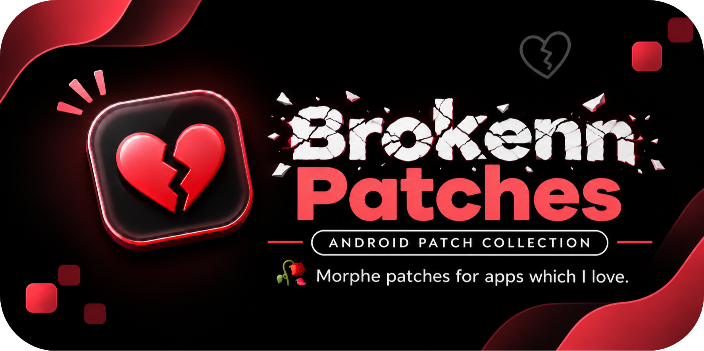

<picture>
  <source media="(prefers-color-scheme: dark)" srcset="https://www.shieldcn.dev/github/release/vippium/brokenn-patches.svg?variant=ghost&amp;size=sm&amp;mode=dark&amp;font=jetbrains-mono&amp;logo=ri%3ATbBrandGithubFilled">
  
</picture>
<picture>
  <source media="(prefers-color-scheme: dark)" srcset="https://www.shieldcn.dev/github/ci/vippium/brokenn-patches.svg?label=pipeline&amp;variant=ghost&amp;size=sm&amp;mode=dark&amp;font=jetbrains-mono&amp;logo=githubactions">
  
</picture>
<picture>
  <source media="(prefers-color-scheme: dark)" srcset="https://www.shieldcn.dev/github/license/vippium/brokenn-patches.svg?variant=ghost&amp;size=sm&amp;mode=dark&amp;font=jetbrains-mono">
  
</picture>
<picture>
  <source media="(prefers-color-scheme: dark)" srcset="https://www.shieldcn.dev/badge/dynamic/json.svg?url=https%3A%2F%2Fraw.githubusercontent.com%2Fvippium%2Fbrokenn-patches%2Fdev%2Fpatches-list.json&amp;query=%24.patches.length&amp;label=patches&amp;logo=ri%3ABsAndroid&amp;variant=ghost&amp;size=sm&amp;mode=dark&amp;font=jetbrains-mono">
  
</picture>

---

##  Patches

<!-- PATCHES_START EXPANDED -->
> **[v1.3.0-dev.1](https://github.com/vippium/brokenn-patches/releases/tag/v1.3.0-dev.1)**&nbsp;&nbsp;•&nbsp;&nbsp;`dev`&nbsp;&nbsp;•&nbsp;&nbsp;17 patches total

📦 OctoGram&nbsp;&nbsp;•&nbsp;&nbsp;6 patches

 

**Package name:** `it.octogram.android`

**🎯 Supported versions:**

| 3.6.1 Beta 2 |
| :---: |

| 💊&nbsp;Patch | 📜&nbsp;Description | ⚙️&nbsp;Options |
|----------|----------------|-----------|
| [Anti-delete messages](#anti-delete-messages) | Prevents server-deleted messages from being removed locally. |  |
| [Anti-disappearing media](#anti-disappearing-media) | Keeps view-once and self-destructing media viewable forever. |  |
| [Bypass content restrictions](#bypass-content-restrictions) | Bypasses restricted-content gates and channel no-forward checks. |  |
| [Enable premium](#enable-premium) | Unlocks premium feature UI and shows the premium badge on self only. |  |
| [Hide typing indicator](#hide-typing-indicator) | Prevents typing status from being sent to other users. |  |
| [Remove sponsored messages](#remove-sponsored-messages) | Stops sponsored messages from being fetched and shown in channels. |  |

📦 JioHotstar&nbsp;&nbsp;•&nbsp;&nbsp;10 patches

 

**Package name:** `in.startv.hotstar`

**🎯 Supported versions:**

| 26.10.26.0 |
| :---: |

| 💊&nbsp;Patch | 📜&nbsp;Description | ⚙️&nbsp;Options |
|----------|----------------|-----------|
| [Bypass signature check](#bypass-signature-check) | Bypasses app signature verification to allow API access. |  |
| [Enable all codecs](#enable-all-codecs) | Unlocks H.265, VP9, AV1 and 4K playback on capable devices. |  |
| [Enable screen mirroring](#enable-screen-mirroring) | Allows playback while screen mirroring or HDMI is connected. |  |
| [Enable screenshots](#enable-screenshots) | Allows screenshots and screen recording. |  |
| [Force HDR10](#force-hdr10) | Enables HDR10 and HDR10+ playback on compatible devices. |  |
| [Monochrome icon support](#monochrome-icon-support) | Adds a themed-icon version of the launcher icon for Android 13+. |  |
| [Premium unlock](#premium-unlock) | Unlocks premium UI features, removes subscription nudges, and enables downloads. |  |
| [Remove ChatGPT Voice Assistant](#remove-chatgpt-voice-assistant) | Strips out the integrated ChatGPT voice assistant module entirely. |  |
| [Remove ads](#remove-ads) | Removes pre-roll, mid-roll, live-match and home-feed ads. |  |
| [Remove top bar switcher](#remove-top-bar-switcher) | Removes the JioHotstar/Tadka switcher from the top of Home. |  |

🌐 Universal&nbsp;&nbsp;•&nbsp;&nbsp;1 patch

 

| 💊&nbsp;Patch | 📜&nbsp;Description | ⚙️&nbsp;Options |
|----------|----------------|-----------|
| [Disable Play Store updates](#disable-play-store-updates) | Disables Play Store updates by setting the version code to the maximum allowed. This patch may cause unexpected issues with some apps and does not work if the app is installed by root mounting |  |

<!-- PATCHES_END -->

## ⚙️ Usage

- Install Morphe Manager on your Android device.
- Click the **Add to Morphe** button above or add https://github.com/vippium/brokenn-patches as a patch source.
- Browse the available patches and check the supported app versions.
- Select the desired patches and apply them using Morphe Manager.

## 🙌 Credits

- [Paresh Maheshwari](https://gitlab.com/Paresh-Maheshwari/paresh-patches) — thanks for the work on the JioHotstar patches
- [MorpheApp](https://github.com/MorpheApp) — the Morphe patcher and tooling

## ⚠️ Disclaimer
>
>**⁉️ Legal Notice**
>
>This project is provided for educational and research purposes only. The patches in this repository modify third-party applications and may violate the terms of service of those applications.
>
>- This project is not affiliated with any of the app developers listed above.
>- Use these patches at your own risk. The author is not responsible for any consequences.
>- If you are a developer or rights holder and believe this project infringes on your rights, please submit a takedown request and the relevant patches will be promptly removed.
>- Users are encouraged to support developers by purchasing legitimate subscriptions if they find the apps useful.

## ⚖️ License

This project is licensed under the
[GNU General Public License v3.0](LICENSE).